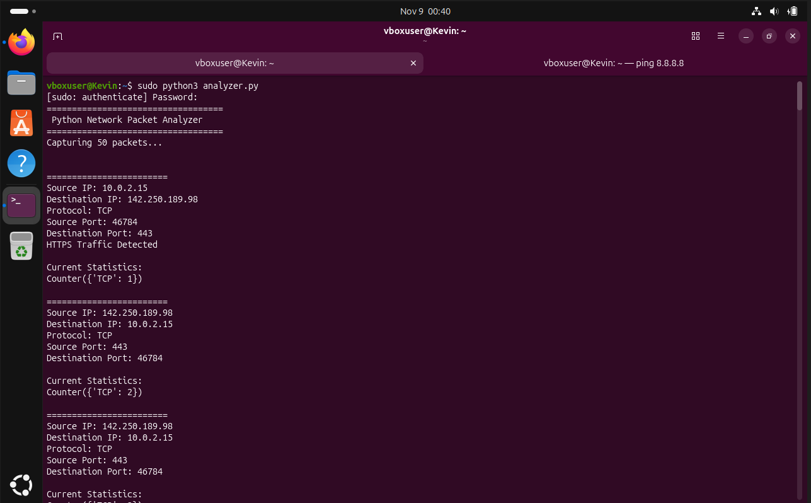
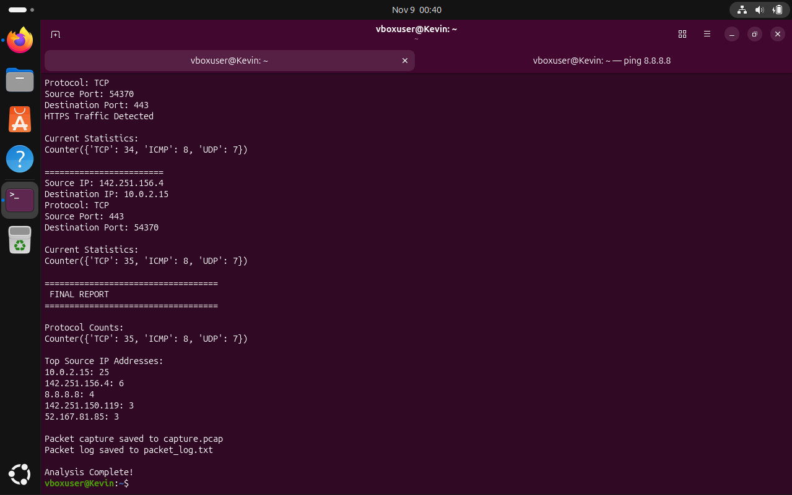
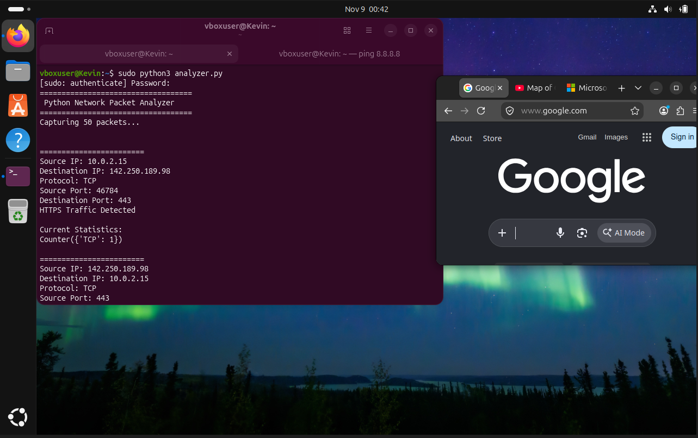
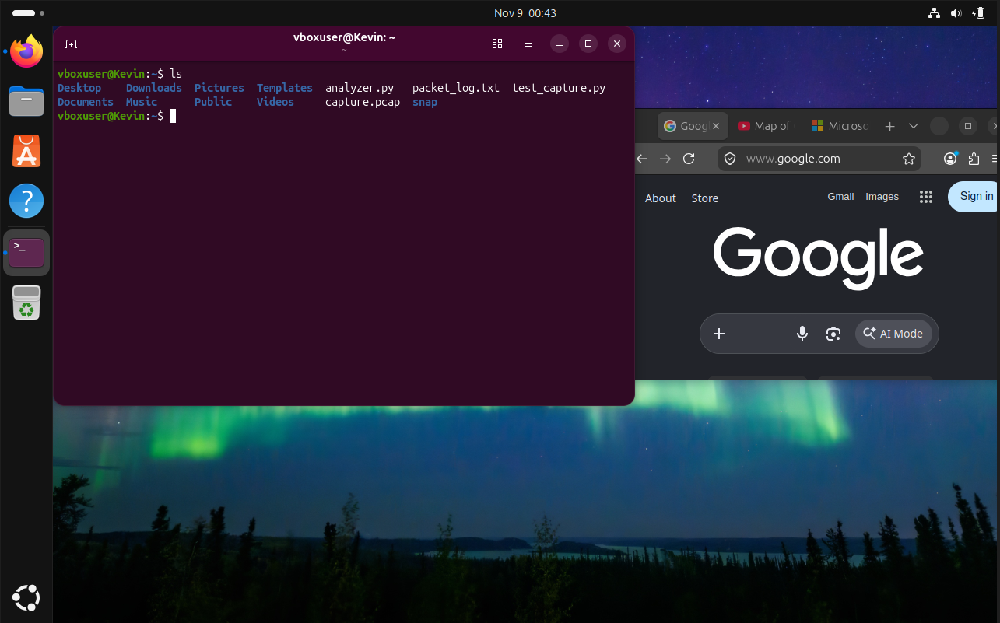

# Python-Network-Packet-Analyzer

My project consists of a Linux-based Network Packet Analyzer built with Python and Scapy that captures and analyzes live network traffic in real time. 

This project was made to gain further understanding of networking and developing practical skills with Linux and Python. 

---

## 1. Capturing multiple packets

This snapshot provides what my packet analyzer looks like when it captured 50 packets, providing deeper detail on what its destination port is. 

---

## 2. Final report

After successfully capturing 50 packets, my network analyzer provides a final report in what IP addresses were captured along with the protocol counts. 

---

## 3. Ubuntu Desktop

This is my showcase of having an additional terminal window pinging 8.8.8.8 to generate traffic along with 3 windows on my Firefox running Google, YouTube, and Microsoft.

---

## 4. Project Files

I listed the files inside of my Ubuntu virtual machine, to indicate what was created for my packet analyzer project.

